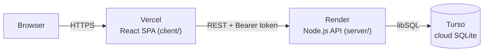

# 💸 FINTECH VAULT — Personal Expense Management Web App

A full-stack personal finance app for tracking income and expenses, comparing spending month over month,
setting category budgets and saving towards goals. Built with **React + Vite + Tailwind CSS** on the front end
and a dependency-light **Node.js REST API** backed by **SQLite / Turso**.

🔗 **Live demo:** [expense-management-web-ef6a.vercel.app](https://expense-management-web-ef6a.vercel.app/)
&nbsp;·&nbsp; 🩺 **API health:** [fintech-vault-api.onrender.com/api/health](https://fintech-vault-api.onrender.com/api/health)

> **Demo account:** `admin@gmail.com` / `123456` — or create your own account in a few seconds.
> The API runs on Render's free tier and sleeps after 15 minutes of inactivity, so the first request may take about a minute.

---

## ✨ Key Features

- **Accounts & Authentication:** Register / log in, edit your profile and change your password. Each user only sees their own data.
- **Command Center (Dashboard):** Virtual asset card with the available balance, total income / expenses, savings rate and top spending categories.
- **Transaction Ledger:** Add, edit, delete, search and filter records by type (income / expense) and category.
- **Monthly Analytics:** Category-level expense breakdown with automatic month-over-month growth for income and expenses.
- **Budgets & Savings Vaults:** Editable monthly limits per category with over-budget alerts; create savings goals and deposit any amount from the available balance.
- **Persistent Storage & Backup:** Data lives in a cloud database (Turso), so it survives server restarts and follows you across devices; one-click `.json` export and demo data reset.
- **Responsive UI:** Sidebar navigation on desktop, bottom tab bar on mobile.

---

## 🏗️ Architecture



| Layer | Hosting | Notes |
| --- | --- | --- |
| UI (`client/`) | Vercel | Static build; API address injected at build time via `VITE_API_URL` |
| API (`server/`) | Render (free) | Configured by `render.yaml`; health check at `/api/health` |
| Database | Turso (free) | Same SQL schema as the local SQLite file used in development |

### Engineering highlights

- **Secure auth without a framework:** passwords hashed with `scrypt` + per-user salt and compared in constant time; random session tokens of which only a SHA-256 hash is stored, so tokens can be revoked on logout and expire after 30 days; login brute-force limiter.
- **Server-side business rules:** amounts, dates and categories are validated on the API. Goal deposits run inside a database transaction that checks the available balance, caps the deposit at the remaining target and records a matching ledger entry; deleting a deposit or a goal rolls the money back.
- **Pluggable database layer:** one async interface with two adapters, built-in `node:sqlite` for local development (zero setup) and `@libsql/client` for Turso in production, selected by an environment variable.
- **Shared domain code:** income / expense categories live in `shared/` and are used by both the UI and the API validation.
- **Tested:** the same API test suite (auth, data isolation between users, validation, deposits, rollbacks, rate limiting) runs against both database adapters with `node:test`.

---

## 🛠️ Tech Stack

- **Frontend:** React (JavaScript), Vite
- **Styling:** Tailwind CSS v4, Custom CSS Micro-interactions
- **Icons:** Lucide React
- **Backend:** Node.js 22 (`node:http`, `node:crypto`, `node:test`), single runtime dependency `@libsql/client`
- **Database:** SQLite (`node:sqlite`) locally, Turso (libSQL) in production
- **Deployment:** Vercel (UI) + Render (API) + Turso (database) — all on free plans

---

## 🚀 Getting Started

Requires **Node.js ≥ 22.13**. The repo is an npm workspace (`client` + `server`), so one install at the root is enough.

```bash
npm install

# Terminal 1 — API on http://localhost:4000
npm run dev:server

# Terminal 2 — UI on http://localhost:5173 (requests to /api are proxied to the API)
npm run dev
```

On first start the API creates a demo account **admin@gmail.com / 123456** with sample data
(disable with `SEED_DEMO=false`). The database file lives at `server/data/fintech-vault.db`.

| Command (run at the root) | What it does |
| --- | --- |
| `npm run dev` | Start the Vite dev server for the UI |
| `npm run dev:server` | Start the API with auto-reload |
| `npm run build` | Build the UI into `client/dist/` |
| `npm start` | Start the API (also serves `client/dist/` if it exists) |
| `npm test` | Run the API test suite (against both the SQLite and the Turso adapter) |
| `npm run lint` | Lint the UI with oxlint |

### Single-server production build

```bash
npm run build
npm start       # open http://localhost:4000
```

### Environment variables

Copy `.env.example` to `.env` at the project root (it is read by both the UI and the API).

| Variable | Used by | Description |
| --- | --- | --- |
| `VITE_API_URL` | UI | API base URL when the UI is hosted separately (e.g. on Vercel). Leave empty locally. |
| `PORT` | API | Port to listen on (default `4000`). |
| `TURSO_DATABASE_URL` | API | Turso database URL (`libsql://…`). When set, the API uses Turso instead of a local file. |
| `TURSO_AUTH_TOKEN` | API | Turso auth token. |
| `DB_PATH` | API | SQLite file path when Turso is not configured (default `server/data/fintech-vault.db`). |
| `CORS_ORIGIN` | API | Allowed origins, comma-separated, or `*` (default). |
| `SEED_DEMO` | API | `false` to skip creating the demo account. |

### Deployment

👉 **Step-by-step guide (Vietnamese): [DEPLOY.md](./DEPLOY.md)**

In short: create a Turso database, deploy the API to Render with the included `render.yaml`
(`TURSO_DATABASE_URL`, `TURSO_AUTH_TOKEN`, `CORS_ORIGIN`), then set `VITE_API_URL` on Vercel and redeploy.

---

## 📡 REST API

All endpoints except register/login/health require `Authorization: Bearer <token>`.

| Method | Path | Description |
| --- | --- | --- |
| `POST` | `/api/auth/register` | `{ name, email, password }` → `{ token, user }` |
| `POST` | `/api/auth/login` | `{ email, password }` → `{ token, user }` |
| `POST` | `/api/auth/logout` | Revoke the current token |
| `GET` / `PATCH` | `/api/auth/me` | Get / update profile (`{ name }`) |
| `POST` | `/api/auth/change-password` | `{ currentPassword, newPassword }` |
| `GET` | `/api/bootstrap` | User, transactions, goals and budgets in one call |
| `GET` / `POST` | `/api/transactions` | List / create `{ type, category, amount, date, note }` |
| `PUT` / `DELETE` | `/api/transactions/:id` | Update / delete a transaction |
| `GET` / `POST` | `/api/goals` | List / create `{ name, target, icon, color }` |
| `DELETE` | `/api/goals/:id` | Delete a goal (its in-app deposits are refunded to the balance) |
| `POST` | `/api/goals/:id/deposit` | `{ amount }` — move money from the balance into a goal |
| `GET` | `/api/budgets` | `{ [category]: amount }` |
| `PUT` | `/api/budgets/:category` | `{ amount }` — set a monthly limit |
| `POST` | `/api/demo/reset` | Replace the user's data with the sample data |

---

## 📁 Project Structure

```
expense-management-web/
├── client/                      # Frontend — React + Vite + Tailwind
│   ├── public/
│   ├── src/
│   │   ├── api/client.js        # fetch wrapper for the REST API
│   │   ├── components/
│   │   │   ├── layout/          # Sidebar, MobileNav, Header
│   │   │   ├── modals/          # TransactionModal, GoalModal
│   │   │   └── ui/              # Modal, Toast, LoadingScreen
│   │   ├── config/navigation.js # menu items
│   │   ├── hooks/
│   │   │   ├── useToast.js
│   │   │   └── useVault.js      # session + data + actions (calls the API)
│   │   ├── pages/               # Login, Overview, Ledger, Analytics, Budgets, Settings
│   │   ├── utils/               # formatting & financial calculations
│   │   ├── App.jsx              # layout, routing between pages, modals
│   │   ├── main.jsx
│   │   └── index.css
│   ├── index.html
│   └── vite.config.js           # @shared alias, dev proxy /api → :4000
├── server/                      # Backend — Node.js + SQLite / Turso
│   ├── src/
│   │   ├── auth/                # password hashing, sessions, login rate limiter
│   │   ├── db/
│   │   │   ├── adapters/        # sqlite.js (local file), libsql.js (Turso)
│   │   │   ├── database.js      # schema + picks the adapter
│   │   │   ├── queries.js       # shared read queries
│   │   │   └── seed.js          # demo account & sample data
│   │   ├── lib/                 # router & HTTP helpers, validation, static files
│   │   ├── routes/              # auth, transactions, goals, budgets, system
│   │   ├── app.js               # wires routes together
│   │   ├── config.js            # environment variables
│   │   └── index.js             # entry point
│   └── tests/                   # one API suite, run against both adapters
├── shared/categories.js         # categories used by both client and server
├── .env.example
├── DEPLOY.md                    # deployment guide
├── render.yaml                  # Render blueprint for the API
├── vercel.json
└── package.json                 # npm workspaces + root scripts
```

---

## 👤 Author

**Võ Thanh An** — [GitHub @Vo-Thanh-An](https://github.com/Vo-Thanh-An)